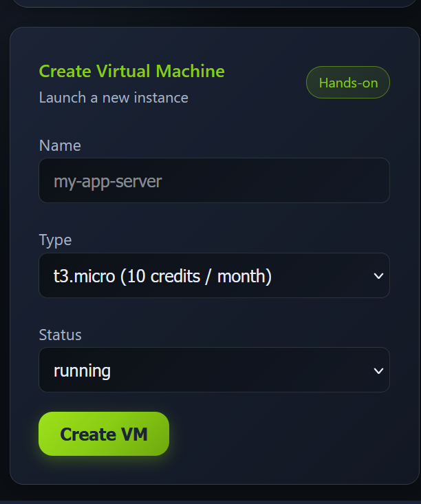
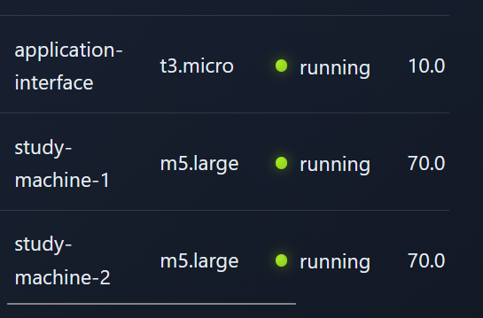
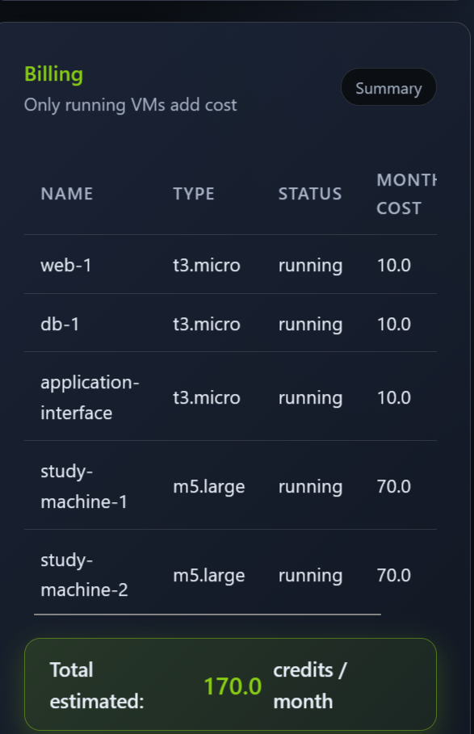
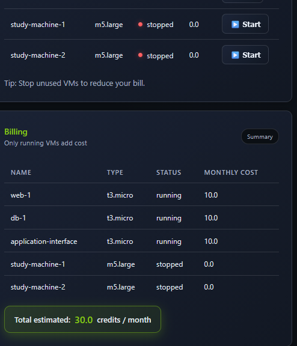

# Cloud Computing Fundamentals — TryHackMe

**Platform:** TryHackMe  
**Topic:** Cloud fundamentals, infrastructure deployment, and cost optimization  
**Progress:** Cloud console deployment and billing exercise

## Cloud computing and the evolution of infrastructure

Cloud computing provides computing resources over the internet rather than relying on one locally hosted computer. The training scenario explores accessibility, reliability, scalability, and changing resource demands.

The evolution discussed in the room:

1. **Physical servers:** Dedicated hardware, commonly one server for one job, with high cost and slow expansion.
2. **Virtualization:** Multiple virtual servers on a physical machine to improve utilization and provisioning.
3. **Automation and remote management:** Managing servers over networks and automating infrastructure operations.
4. **Cloud computing:** Renting computing and storage resources on demand and scaling elastically.
5. **Modern cloud:** Global platforms and container-based application delivery.

Key cloud characteristics include scalability, on-demand self-service, usage-based pricing, infrastructure security, high availability, and global access.

## Cloud deployment and service models

| Deployment model | Description |
| --- | --- |
| **Public cloud** | Provider-managed cloud infrastructure for broad application deployment and scaling |
| **Private cloud** | Greater control and customization for sensitive or regulated workloads |
| **Hybrid cloud** | A combination of private and public environments |

| Service model | User manages | Provider manages |
| --- | --- | --- |
| **IaaS** | Operating system and applications | Physical infrastructure |
| **PaaS** | Application development and deployment | Infrastructure and operating system |
| **SaaS** | Use of the application | Underlying application service and infrastructure |

## Cloud service providers

The room introduces AWS, Microsoft Azure, Google Cloud, Alibaba Cloud, IBM Cloud, and Oracle Cloud and discusses examples of cloud usage in streaming, social platforms, and e-commerce.

## Practical: Simulated cloud console

### Region selection

The cloud console displayed the region **`us-east-1 (N. Virginia)`**. Choosing a region defines where cloud resources are deployed.

### Launching a virtual machine

The **Create Virtual Machine** screen displayed these selections:

| Setting | Value shown |
| --- | --- |
| Name | `my-app-server` |
| Instance type | `t3.micro` |
| Initial status | `running` |
| Displayed monthly cost | 10 credits |

An EC2 instance is a virtual computer in the cloud. Its instance type determines the resource capacity and affects the cost.

### Reviewing instances

The console showed the following running virtual machines:

| Instance | Type | Running cost (credits/month) |
| --- | --- | ---: |
| `web-1` | `t3.micro` | 10 |
| `db-1` | `t3.micro` | 10 |
| `application-interface` | `t3.micro` | 10 |
| `study-machine-1` | `m5.large` | 70 |
| `study-machine-2` | `m5.large` | 70 |
| **Total** | | **170** |

### Cost optimization: Stop unused instances

The two larger study instances were then stopped. In the exercise's simulated billing model, only running VMs contributed to the monthly estimate.

#### Billing before stopping instances

| Instance group | Before | After |
| --- | ---: | ---: |
| Three `t3.micro` instances | 30 | 30 |
| Two `m5.large` instances | 140 | 0 |
| **Estimated total (credits/month)** | **170** | **30** |

**Result:** A reduction of **140 credits/month**, approximately **82.4%**, in the simulated environment.

#### Billing after stopping instances

> The above credits and stopped-instance billing behavior refer to the training simulator, not a quotation of real AWS billing.

## Practical takeaways

- Select the cloud region before provisioning infrastructure.
- Choose instance types based on performance needs and cost.
- Create and manage virtual computers through a cloud console.
- Review running versus stopped instance states.
- Identify unused compute resources and reduce simulated operating costs.
- Connect the exercise to the **IaaS** model, where control of the guest operating system is valuable for cybersecurity tooling and training.

## Visual evidence

The exercise captured five screens: **region selection**, **virtual machine creation**, **instance inventory**, **billing before shutdown**, and **billing after stopping two instances**.
