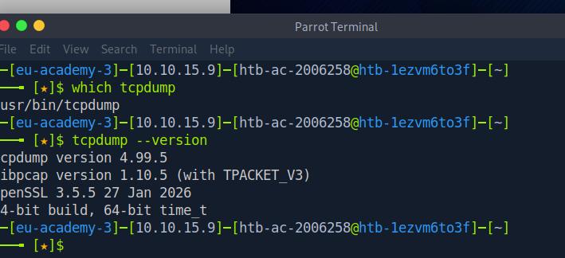
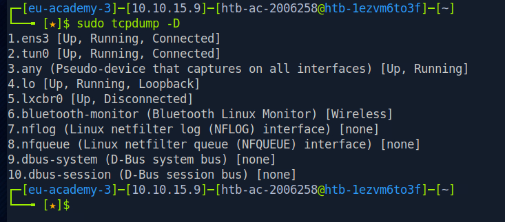
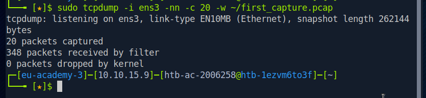
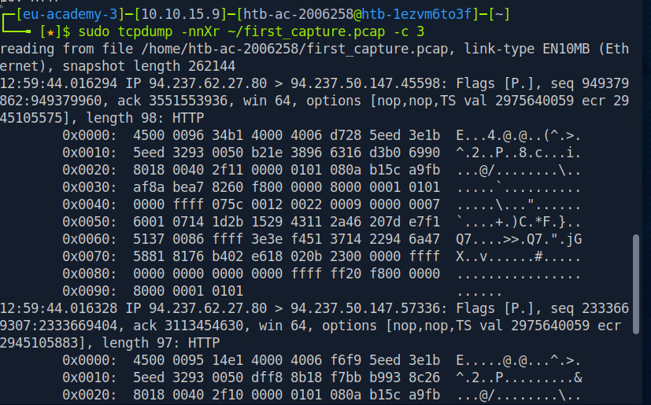

# Tcpdump Fundamentals — HTB Practical Exercise

**Platform:** Hack The Box Academy  
**Topic:** Network Traffic Analysis  
**Status:** Fundamentals capture exercise completed; packet-filtering concepts and assessment questions completed; optional advanced PCAP investigation not performed

## Objective

Verify tcpdump availability, identify available capture interfaces, collect a bounded sample of network traffic, save packets to a PCAP file, and inspect captured packets offline. The exercise used an isolated HTB training VM, not a personal HomeLab.

## Verified workflow

### 1. Confirm tcpdump is available



```bash
which tcpdump
tcpdump --version
```

The terminal confirmed that tcpdump was installed. The displayed version was **4.99.5**, with **libpcap 1.10.5**.

### 2. Discover capture interfaces



```bash
sudo tcpdump -D
```

The VM reported multiple interfaces. **ens3** was selected for the packet-capture exercise; this is a reminder not to assume every Linux system uses an interface named `eth0`.

### 3. Capture a small traffic sample



```bash
sudo tcpdump -i ens3 -nn -c 10
```

- `-i` selects an interface.
- `-nn` disables address and port-name resolution.
- `-c` limits the number of captured packets.

The terminal displayed live TCP traffic, including traffic identified as HTTP.

### 4. Save a bounded PCAP

```bash
sudo tcpdump -i ens3 -nn -c 20 -w ~/first_capture.pcap
ls -lh ~/first_capture.pcap
```

**Observed result:** 20 packets captured, 0 packets dropped by kernel, and a PCAP file of approximately 34 KB. A bounded capture avoids leaving an unrestricted collection running.

### 5. Read saved packets


```bash
sudo tcpdump -nnr ~/first_capture.pcap
```

The stored capture was read successfully. The output included TCP and UDP packets and traffic identified as HTTP. Source/destination addressing, port numbers, TCP flags, and packet lengths were visible.

### 6. Inspect packet bytes



```bash
sudo tcpdump -nnXr ~/first_capture.pcap -c 3
```

The output displayed hexadecimal and ASCII representations of packet bytes. `-X` includes IP-header bytes and transport/application data; not every byte corresponds to readable application text.

## Technical takeaways

| Option | Function |
|---|---|
| `-D` | List capture interfaces |
| `-i` | Select an interface |
| `-n` / `-nn` | Disable hostname resolution / hostname and service-name resolution |
| `-c` | Stop after a packet count |
| `-w` | Write raw packets to PCAP |
| `-r` | Read a saved PCAP |
| `-X` | Show packet data in hex and ASCII |
| `-v` | Show more verbose packet details |
| `-l` | Line-buffered output for streaming through pipes |

## Packet filtering — subsequent HTB section

After the capture-and-read exercise, the HTB Academy packet-filtering section and its assessment questions were completed. The following filter syntax and interpretation were studied:

| Filter | Meaning |
|---|---|
| `host 10.10.20.1` | Match traffic to or from the specified host |
| `src host 10.10.20.1` | Match packets sent by that host |
| `dst host 10.10.20.1` | Match packets destined for that host |
| `tcp port 443` | Match TCP traffic using source or destination port 443 |
| `port 53` | Match traffic using port 53 in either direction |
| `portrange 0-1024` | Match ports in the specified range |
| `icmp or port 443` | Match either condition |
| `host 10.10.20.1 and port 443` | Require both conditions |
| `not icmp` | Exclude ICMP packets |
| `less 64` / `greater 500` | Filter by packet length |

The section also covered the distinction between filtering packets while capturing and filtering a saved PCAP during review. The `-n` option suppresses hostname resolution; `-nn` additionally suppresses service-name resolution. These examples represent **concepts studied**, not independently verified commands executed in the advanced exercise.

### Optional advanced PCAP exercise — scope limitation

The **Interrogating Network Traffic With Capture and Display Filters** exercise called for examining `TCPDump-lab-2.zip`, identifying the first TCP handshake and determining the DNS server. The required capture was not available in the training VM during the attempted walkthrough. The practical investigation was **skipped**; its answers were completed separately, without independently reproducing the packet analysis. No server IPs, handshake ports, timestamps, or DNS findings are claimed here.

### Next learning topic

**Wireshark** is the next HTB Academy topic. It is not marked as completed.

## Security operations relevance

This workflow supports initial network baselining, traffic triage, packet-level inspection, and preservation of a small packet sample for later analysis. Observing an unusual port or protocol alone does **not** establish malicious activity or compromise.

## Evidence handling

The exercise was performed on an HTB training VM. The five terminal screenshots are included as evidence from the HTB training VM. They were reviewed for unnecessary sensitive information before publication. The PCAP itself is not included. No private HomeLab captures or configuration are included.

## Scope

This page distinguishes the verified capture-and-read workflow from packet-filtering concepts studied and the advanced investigation that was skipped. It does not claim an incident was discovered or a real enterprise network was assessed.
