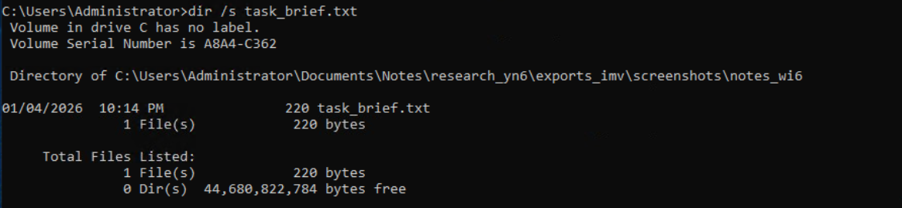
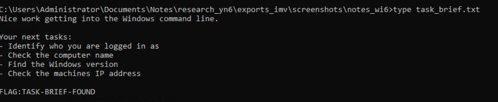

# Windows CLI Basics — TryHackMe

**Status:** Completed  
**Platform:** TryHackMe  
**Focus:** Windows Command Prompt navigation, file discovery, text inspection, and host/network information.

## Overview

Windows Command Prompt (CMD) provides a text-based way to navigate directories, locate files, read text, and inspect a system. These commands are useful during basic administration and initial host triage.

## Navigation and directory listings

| Command | Purpose |
| --- | --- |
| `cd` | Display or change the current directory |
| `cd ..` | Move to the parent directory |
| `cd /d D:\\folder` | Change drive and directory in one command |
| `dir` | List files and directories in the current location |
| `dir /a` | Include files with hidden or system attributes |

CMD paths use backslashes. Use quotes around a path that contains spaces, for example: `cd "C:\\Program Files"`.

## Recursive file search

Use `dir /s filename` to search the current directory and all its subdirectories. For example:

```cmd
dir /s task_brief.txt
```

The output identifies matching paths, which can then be used to inspect a file.

### Finding `task_brief.txt` with `dir /s`

The screenshot records the recursive search for the task brief and the path returned by CMD.



## Reading text files

Use `type` followed by a filename or path to print a text file in the Command Prompt window:

```cmd
type task_brief.txt
```

For a path that contains spaces, quote the path: `type "C:\\Some Folder\\task_brief.txt"`.

### Reading `task_brief.txt` with `type`

The screenshot shows the task brief opened in CMD with the `type` command.



## System and network information

| Command | Information |
| --- | --- |
| `whoami` | Current user in domain\\username or local-machine\\username form |
| `hostname` | Computer's network name |
| `systeminfo` | Detailed Windows version, configuration, hardware, and update information |
| `ipconfig` | Network adapter configuration, including IPv4/IPv6 addresses and gateways |

These commands provide a basic inventory of the current host and its network configuration. Interpret network output in context: an address or active adapter alone does not establish that a host is exposed or compromised.

## Security relevance

CMD navigation and search help locate configuration and evidence files. `type` supports quick inspection of readable text, while `whoami`, `hostname`, `systeminfo`, and `ipconfig` help establish which account and host are being examined and summarize basic system and network details.
