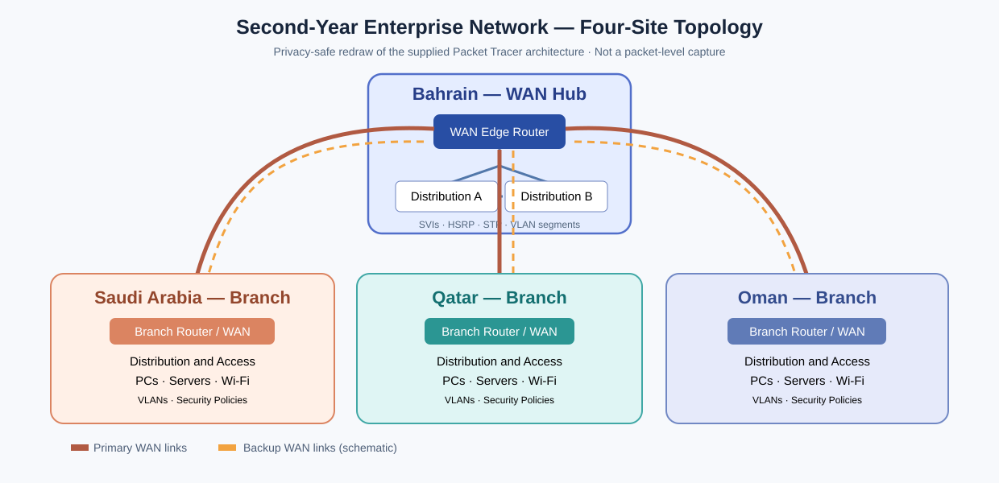

# Second-Year Enterprise Network — Cisco Packet Tracer

## Goal and architecture
A four-site simulated enterprise network connecting **Bahrain, Saudi Arabia, Oman and Qatar**. Bahrain is the WAN hub; the other locations are branches. Each site has switching, routers, departmental PCs, servers and wireless equipment. The design considers campus segmentation, intersite connectivity, redundant links, gateway availability, WAN failover, selective Internet access and secure administration.

This was a **second-year practical project**. The notes below explain configurations and verification output in the original 48-page report, without uploading the report itself. Technical IP ranges and VLANs are lab examples; all personal names, student numbers and authentication secrets are intentionally excluded.

## Detailed technical chapters
1. [IP addressing, VLANs and inter-VLAN routing](01-architecture-addressing-vlans.md)
2. [STP, HSRP and redundant WAN](02-redundancy-wan.md)
3. [Port security, DHCP snooping, SSH and ACL policies](03-security-acls.md)
4. [NAT, PAT, published web/mail services and Wi-Fi](04-nat-wireless.md)
5. [Verification commands, actual evidence and limitations](05-validation-findings.md)

## Main learning
**Segmentation:** a VLAN creates a Layer 2 broadcast boundary, while an IP subnet creates a Layer 3 address boundary. SVIs route between VLANs subject to ACLs.

**Resilience:** STP prevents loops from redundant switch links; HSRP provides stable default gateways; floating static routes can prefer secondary WAN paths after primary route loss.

**Security:** secure administrative access by SSH/IT-only ACL, switch port security, DHCP snooping and scoped user/service traffic permissions.

**Internet edge:** PAT shares an external address, static mappings publish only selected services; NAT alone does not establish a firewall policy.

**Validation:** screenshots of a command must be interpreted, including cases where a feature was initially disabled and later enabled. Positive and negative traffic tests should support the access-control objectives.

**Image status:** The original four-site Packet Tracer topology screenshot was provided for this portfolio. The image has been visually reviewed for obvious identifying information, but is **not yet committed** to this repository. The diagram below remains a privacy-safe redraw until the original image is uploaded and linked. Other source-report screenshots remain unpublished pending review.
## Network topology diagram

**Diagram interpretation:** Bahrain is the WAN hub connected to KSA, Qatar and Oman branches through primary/backup paths. Each location includes a WAN edge, distribution/access switching, departmental VLANs, servers and wireless. This is a **privacy-safe vector redraw based on the original Packet Tracer topology**, not the original screenshot. It illustrates the network architecture while avoiding team or student-identifying information. Exact physical interface assignments belong to the original lab evidence.
