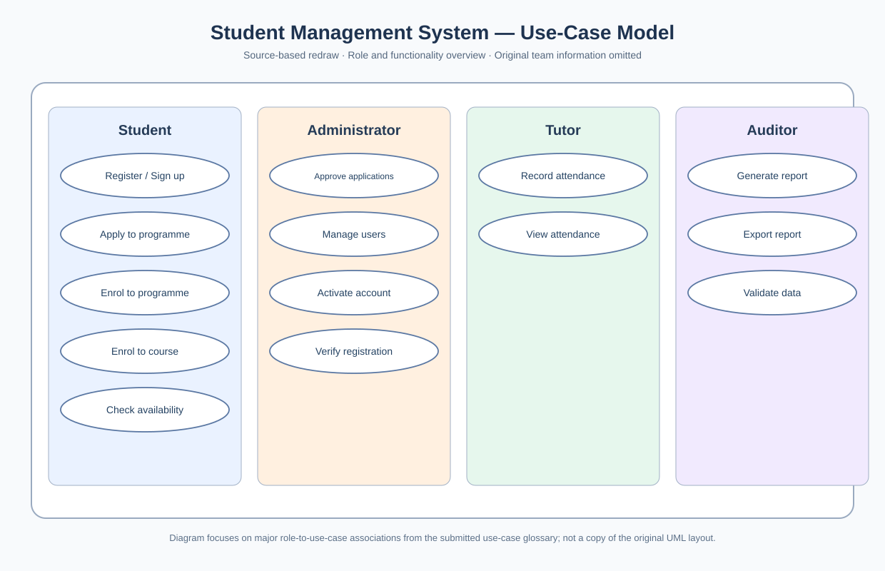
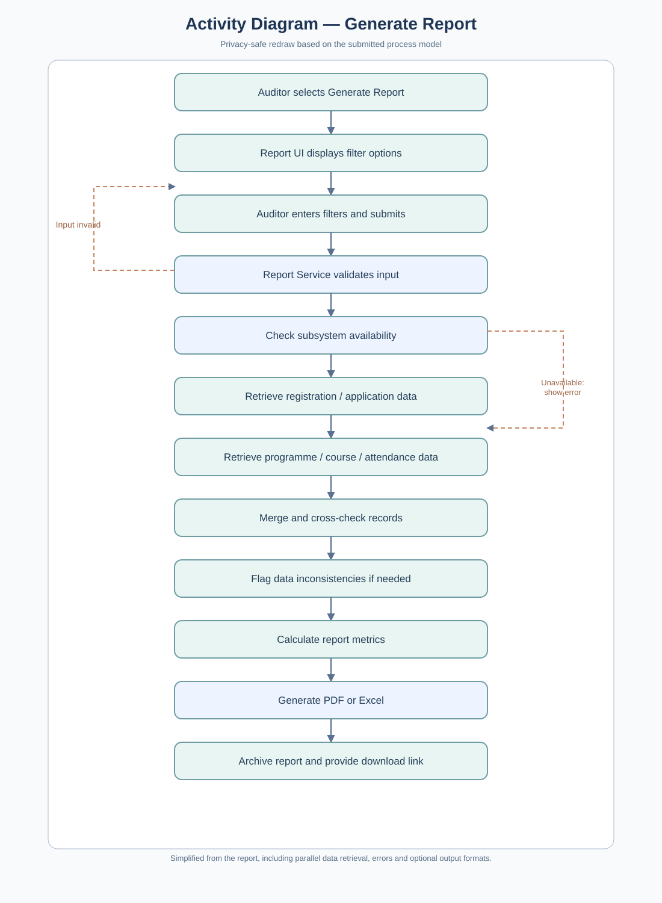
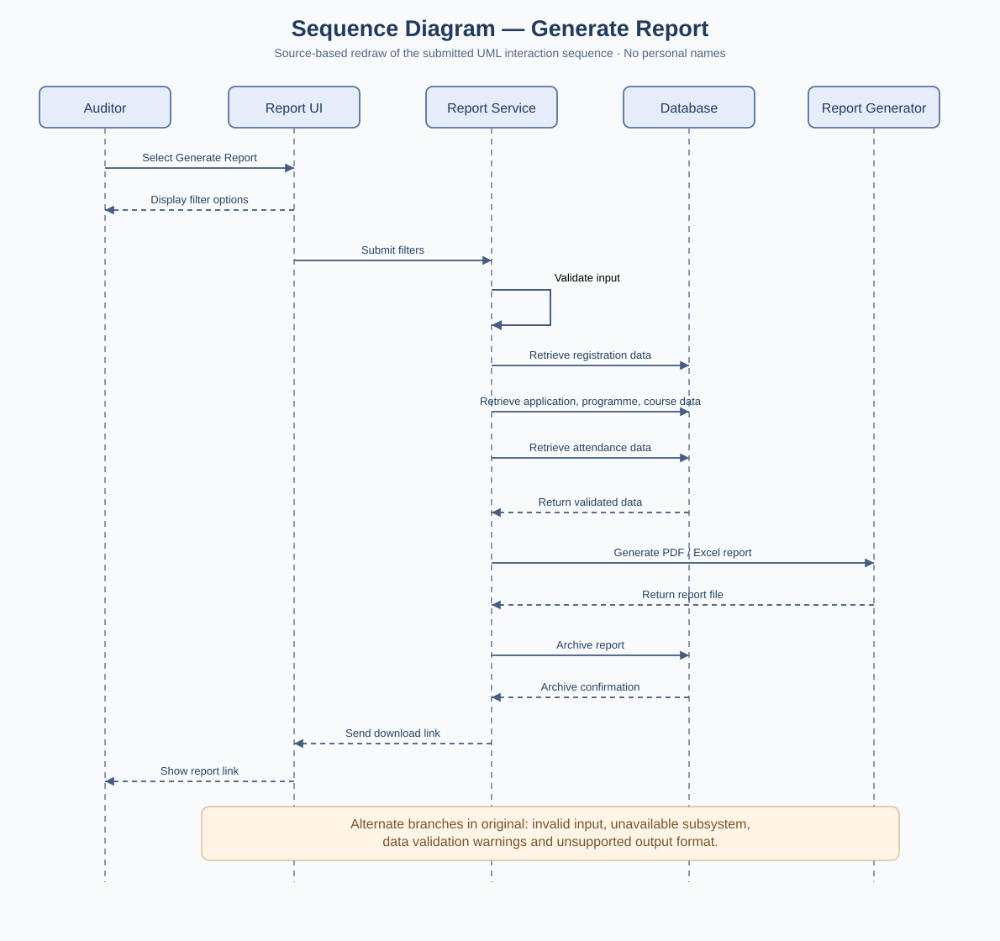

# UML Models — Use Case, Activity, Sequence and Class Concepts

## Use Case Model Diagram
The source document contains a **use-case model diagram** relating user roles (Student, Admin, Tutor and Auditor) to system operations. The **actor** represents an external role, the **system boundary** identifies what is inside the proposed software, and the use cases represent actor goals. The model helps check that every capability in the requirements and actor glossary has a responsible role.

## Activity Diagram — Generate Report
The supplied report includes an **activity diagram for report generation**. This presents the process as actions connected by control-flow arrows with decisions and alternate routes. Reading it requires distinguishing:
- Initial/final nodes: beginning and end of the process.
- Activities: tasks performed in the workflow.
- Decision/merge nodes: where mutually exclusive branches split or rejoin.
- Possible fork/join semantics: simultaneous activities versus alternate paths.

**Lesson:** An activity diagram describes the *workflow and decisions*, not which object sends a specific message.

## Sequence Diagram — Generate Report
The report also contains a **sequence diagram for report generation**, ordering interactions between the requesting actor and collaborating system components. Participants have lifelines, while arrows denote requests/responses. Conditional fragments can represent report validation, missing information and alternative service behavior.

**Lesson:** A sequence diagram answers *who interacts with whom and in what order*, unlike an activity diagram, which focuses on *what business process happens next*. Its messages should be consistent with the matching use case.

## Class Diagram — Completed
**Status: Yes — completed as part of the second-year project**, as confirmed by the project owner. The original diagram is not included in this portfolio, so its exact attributes, methods, and relationships are not reproduced here.

## Consistency checks
- Course enrolment behavior requires checks for prerequisites, seats and scheduling conflicts.
- Attendance requires an assigned tutor and a selected section before any save.
- Report generation requires permitted report roles and access to the necessary records.
- The models are **design artifacts**, not evidence of deployment or working source code.

**Source evidence:** use-case model around report page 13; activity diagram for Generate Report around page 24; sequence diagram for Generate Report around page 26. Original diagram images are not published because identifying information also appears throughout the submitted document.
## View the diagrams

These diagrams are reconstructed from the project source and its reported actors/flows, with identifying elements excluded. Their geometry and level of detail may differ from the original PDF screenshots.
