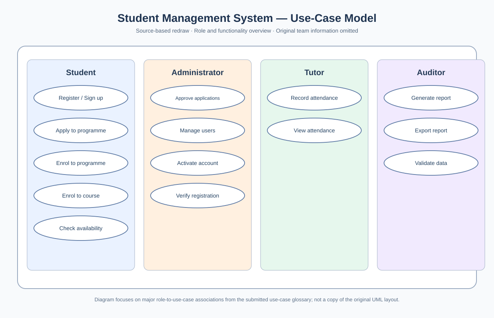
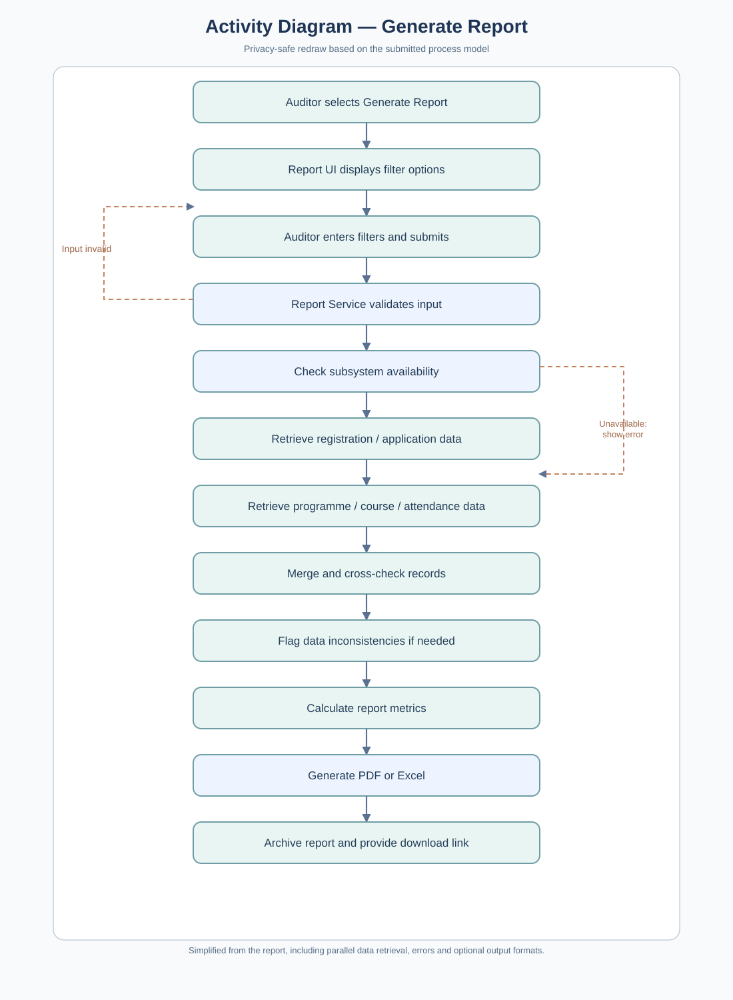
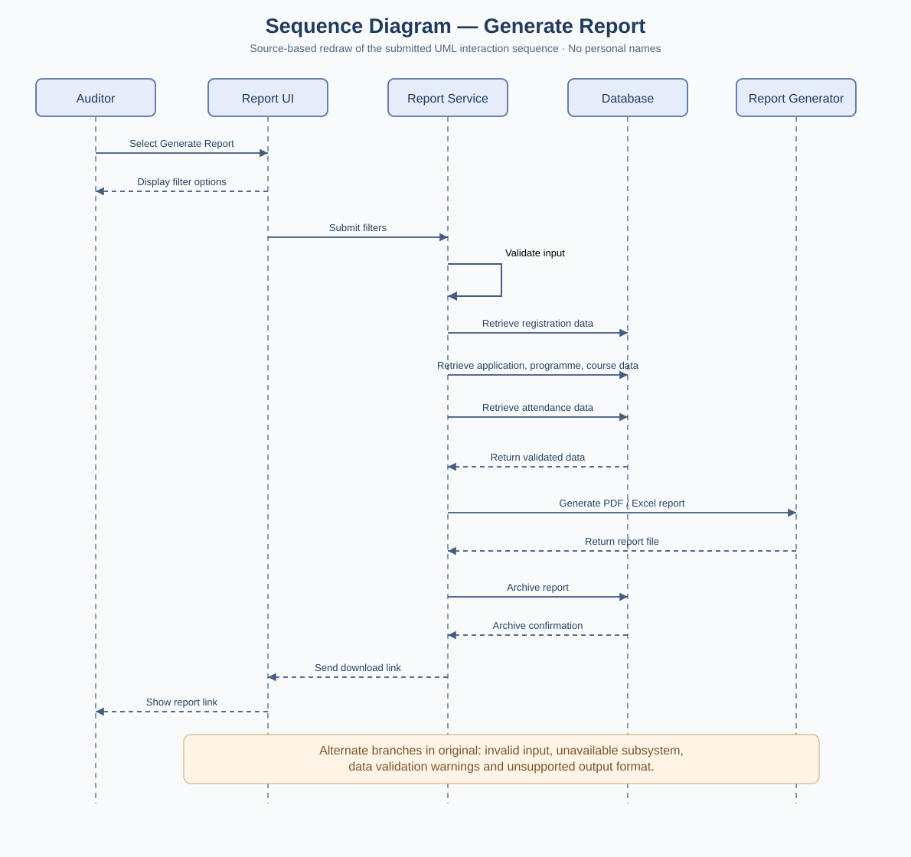

# Systems Analysis and Design — Student Management System

## Project overview
**Second-year academic project | Systems Analysis and Design**

Worked on the analysis and proposed design of a multi-role **Student Management System** for a fictional academic institute. The project addressed difficulties with manual registration, programme/course enrolment, attendance tracking, reporting and administrative processing as student demand increased.

**Scope of the submitted work:** service request, project planning, problem analysis, interview and stakeholder research, functional/non-functional requirements, use-case modeling and narratives, activity and sequence diagrams, preliminary interface mockups, and feasibility/cost-benefit analysis. These are **analysis and design deliverables**; the supplied report is **not** evidence that a production application, live payment gateway or operational database was deployed.

**Privacy:** This portfolio does not include the original report, student IDs, participant names, contact details, signatures, meeting attendee lists or secret credentials. The original file name is also not reproduced.

## Detailed documentation
1. [Business problem, service request and research](01-problem-and-research.md)
2. [Functional and non-functional requirements](02-requirements-and-traceability.md)
3. [Actors, use cases and detailed scenarios](03-use-cases-and-scenarios.md)
4. [UML behavioral models and diagram interpretation](04-uml-diagrams.md)
5. [User interface design and user journeys](05-user-interface-design.md)
6. [Planning, feasibility and cost-benefit analysis](06-planning-and-feasibility.md)
7. [What I learned, validation and limits](07-lessons-and-evidence.md)

## Main skills demonstrated
- Translate an operational problem into objectives, scope and measurable requirements.
- Distinguish **functional** behavior from **non-functional** quality constraints.
- Link requirements to stakeholders, actors, use cases, diagrams, interface screens and tests.
- Define **preconditions**, **triggers**, **main success flows**, **alternate flows**, **postconditions**, **business rules** and **open issues** in use-case narratives.
- Draw and reason about **use-case**, **activity** and **sequence** diagrams as different views of the same system.
- Design workflows for registration, admission, enrolment, attendance and reporting while recognizing security/privacy implications.
- Plan tasks, dependencies and milestones using a Gantt-style schedule and evaluate technical, economic and organizational feasibility.

## Model and evidence coverage
The supplied report includes a **use-case model**, an **activity diagram for report generation** and a **sequence diagram for report generation**. Class-diagram work is reported as part of the second-year learning, but no class diagram is visible in this particular supplied PDF; it is not represented here as source-verified evidence. UI illustrations and charts are described in text without republishing identifying screenshots.

**Screenshot policy:** This project is **text-and-diagram-explanation only**. Screenshot evidence folders are reserved for Cisco Networking, Defence in Depth, Ethical Hacking and Huawei Network Security; not Artificial Intelligence or this project.

## Project diagrams (privacy-safe visual reproductions)

### Use-case model

The diagram groups the major Student, Administrator, Tutor and Auditor functions reflected in the original use-case glossary. It is a **source-based simplified redraw**, not the original screenshot.

### Activity diagram — Generate Report

Shows report selection, filter entry, validation, data retrieval, cross-checks and report generation including exceptions. It is a **simplified redraw** of the report's activity process.

### Sequence diagram — Generate Report

Shows message order between Auditor, UI, service, database and report generator, including report archival and a returned download link. This is a **source-based redraw**, not a verbatim copy of the original UML drawing.

**Privacy:** No student IDs, author names, interviewee identities, signatures, credentials or raw report images are used.
